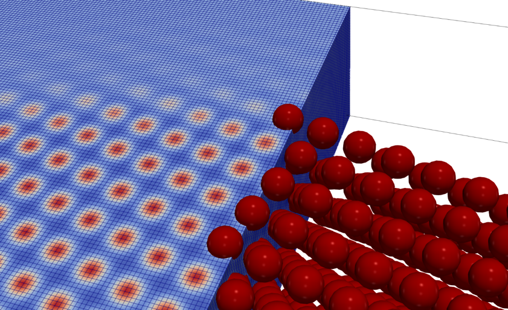
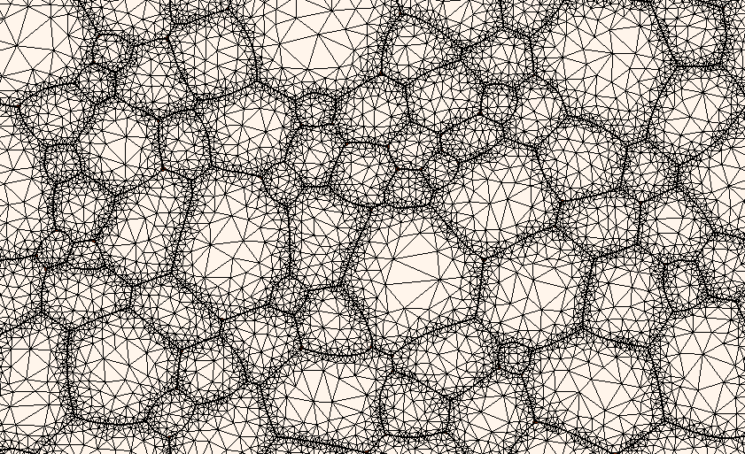
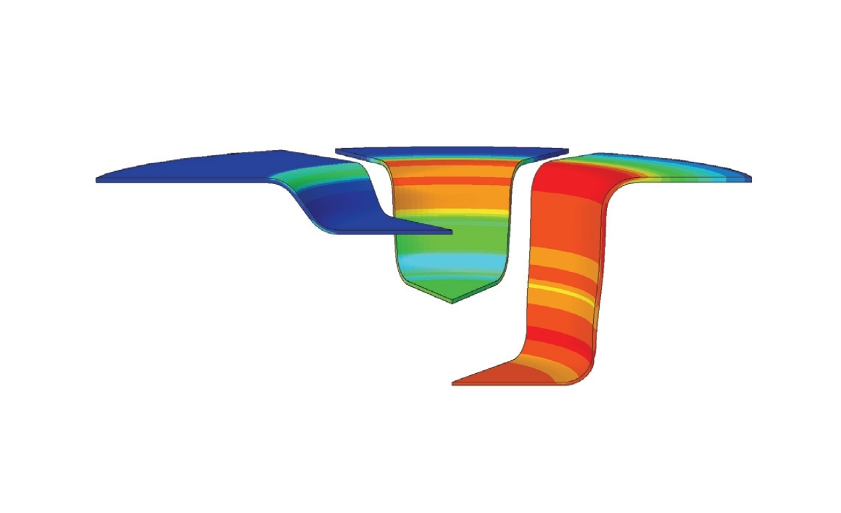
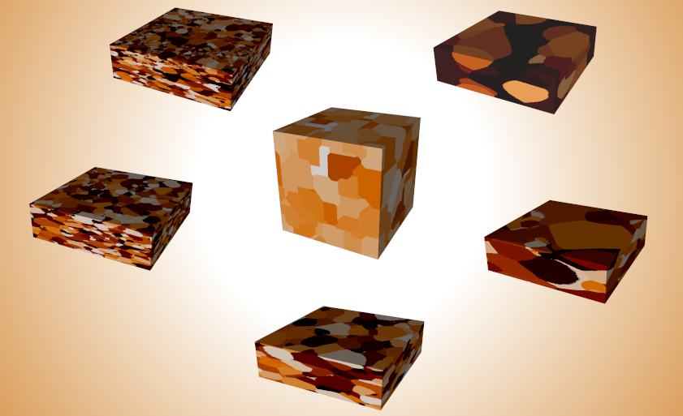

These pages illustrate some of our work, mainly related to microstructure mechanics in crystalline materials. My main research interests include:

- Grain boundary mechanics
- Plasticity across multiple length scales
- Recrystallization and grain growth
- Phase transformations

The work combines modeling of physical mechanisms with the development of efficient numerical algorithms, often integrated with experimental materials characterization.

             |  |
 |              |
